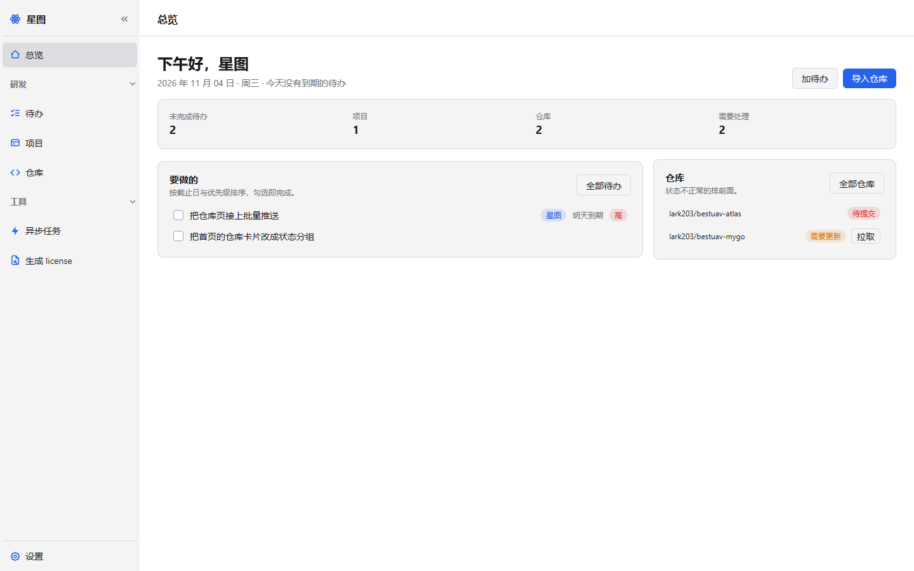
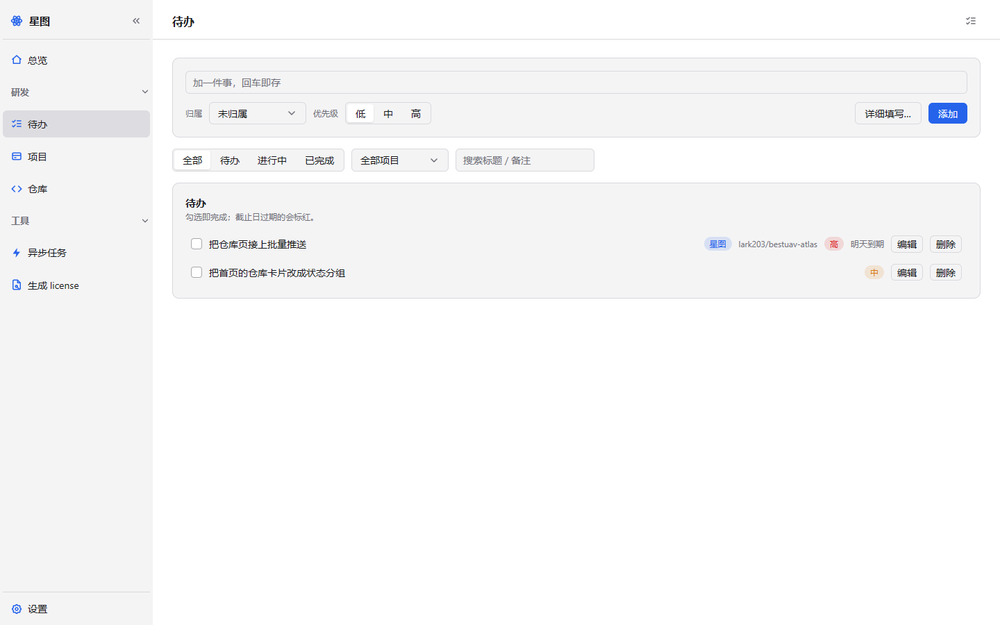
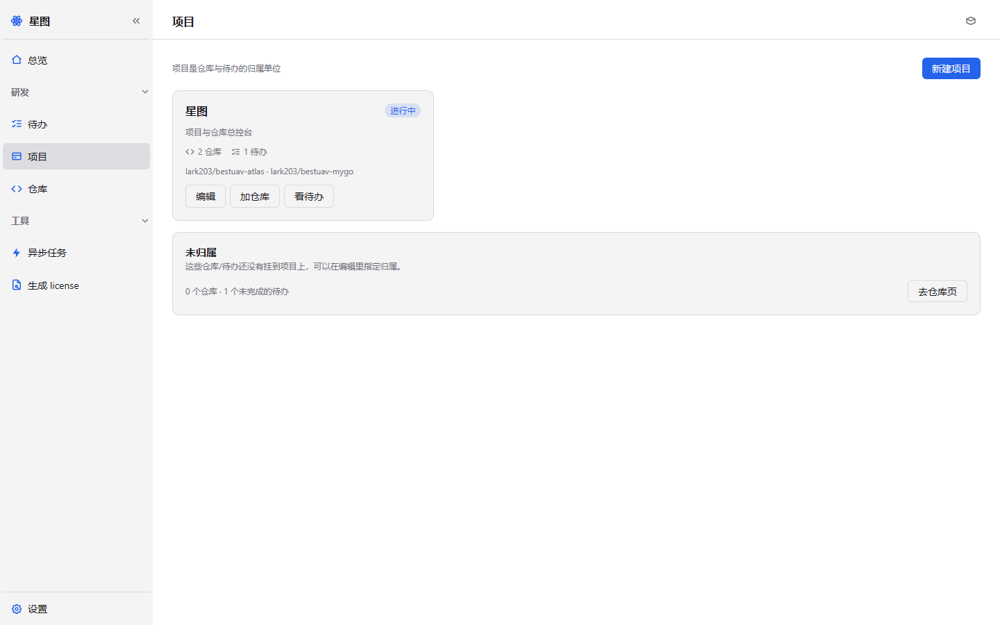
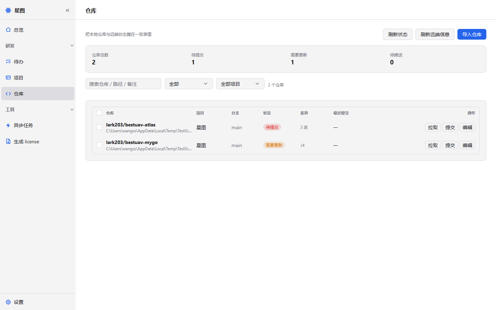
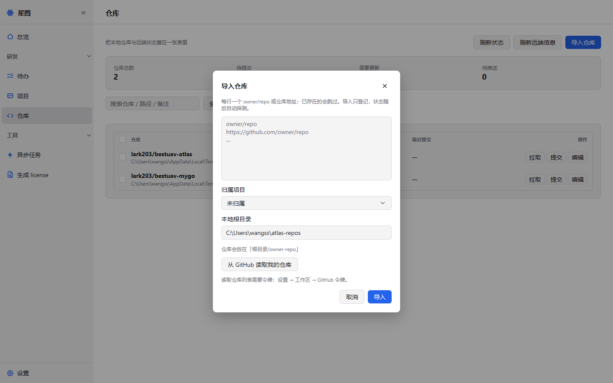
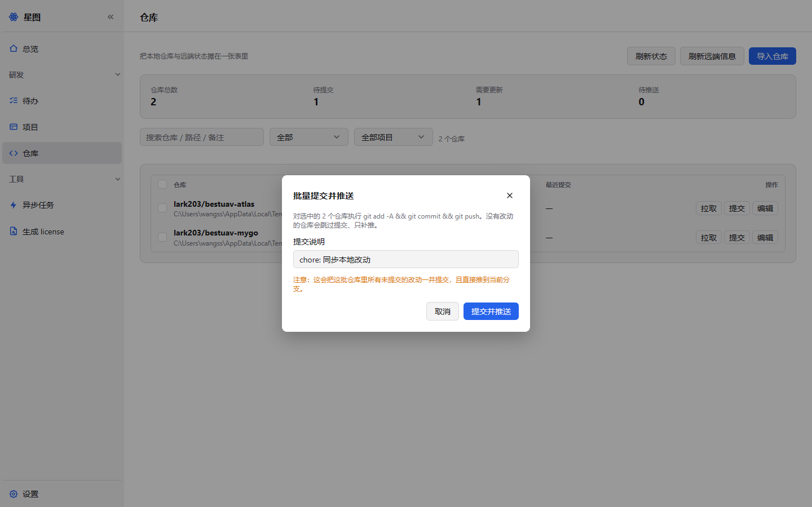

# 星图 · bestuav-atlas

> 把「待办 / 项目 / 多个 GitHub 仓库」摊在一张图上的本地桌面工作台。
> 纯 Go + [mygo](https://github.com/egoist/mygo) 原生绘制，无 webview；数据只存本机 SQLite，联网只在**你点按钮**的时候发生。

---

## 一、它解决什么

项目一多，日常就变成三件事的来回切换：

1. **我该做什么？** —— 待办散在脑子里、便签里、Issue 里；
2. **这件事属于谁？** —— 十几个仓库，哪些属于「星图」、哪些属于「量子科学」，靠记；
3. **代码同步到哪一步了？** —— 哪个仓库有没提交的改动、哪个落后远端、哪个提交了没推。

星图把这三件事放进一个窗口：**项目是归属单位，待办是执行单元，仓库是代码落点**。
一屏看清「今天要做什么」和「哪些仓库需要动手」，需要时再批量拉取、批量提交推送。

## 二、功能

- **待办**：快速输入（回车即存）、优先级、截止日、挂项目/挂仓库、勾选完成、按状态与项目筛选
- **项目**：新建/编辑/暂停/归档，卡片上直接显示仓库数、未完成待办数与仓库清单
- **仓库**：一次导入多个（`owner/repo` 每行一个，或从 GitHub 读列表）；表格展示
  **状态 / 差异 / 分支 / 最近提交**；行内可拉取、提交、编辑
- **批量操作**：勾选多个仓库后，从底部批量条执行「批量拉取」「批量提交并推送」「刷新状态」「刷新远端信息」
- **状态是算出来的**（不是手填）：待提交 / 需要更新 / 待推送 / 正常 / 未克隆 / 错误
- **手动联网**：GitHub API 只在「从 GitHub 读取我的仓库」和「刷新远端信息」时调用，没有定时器、没有后台轮询
- **本机存储**：SQLite（纯 Go 驱动，无 cgo）；配置、库、日志都在系统用户目录，可在「设置 → 关于与诊断」里打开
- 主题/字号/侧栏收缩/背景图/自动更新/托盘/单实例等桌面能力沿用 bestuav-mygo 底座

## 三、界面

截图由 `ui.NewTester` 离屏渲染生成（脚本见「本地开发」），不依赖显示器。

| 总览 | 待办 |
|---|---|
|  |  |

| 项目 | 仓库 |
|---|---|
|  |  |

| 导入仓库（多行 / 读取 GitHub 列表） | 批量提交并推送 |
|---|---|
|  |  |

## 四、三步上手

1. **建项目**：项目页 →「新建项目」。按「一件事」分组即可，例如「星图」「量子科学桌面端」「内部工具链」。
2. **导仓库**：仓库页 →「导入仓库」。把 `owner/repo` 每行一个粘进去；
   或者先在「设置 → 工作区」填 GitHub 令牌，点「从 GitHub 读取我的仓库」。
   本地目录默认放在「设置 → 工作区 → 仓库根目录」下的 `owner-repo/`。
3. **记待办**：待办页顶部输入框写一句话，回车。

之后打开总览：左边是要做的事，右边是状态不正常的仓库。

## 五、技术栈

| 项 | 选型 |
|---|---|
| 语言 | Go 1.27+（不需要 CGO，可纯 Go 交叉编译） |
| UI | [mygo](https://github.com/egoist/mygo) v0.7.4（即时模式 UI、GPU 自绘） |
| 组件 | [CrychicUI](https://github.com/ELY-Open-Source/CrychicUI)：DataTable / SelectTable / BulkBar / Stat / EmptyState / Modal / Dropdown |
| 持久化 | SQLite（`modernc.org/sqlite`，纯 Go） |
| Git | 本机 `git` 命令（`internal/gitx`，纯本地读写，不接管凭据） |
| GitHub | REST API（`internal/github`，只在手动触发时调用） |
| 测试 | `ui.NewTester` 离屏渲染断言 + `httptest` + 临时 git 仓库 |

## 六、目录结构

```
bestuav-atlas/
├── main.go                    # 入口：日志 → 数据库 → 单实例锁 → 窗口/托盘
├── mygo.json                  # 打包与自动更新配置
├── internal/
│   ├── view/
│   │   ├── registry.go        # ★ 菜单/页面/页头按钮的唯一注册处
│   │   ├── page_overview.go   # 总览（首页）
│   │   ├── page_todos.go      # 待办
│   │   ├── page_projects.go   # 项目
│   │   ├── page_repos.go      # 仓库（表格 + 批量条）
│   │   ├── atlas_data.go      # 三页共用的数据快照、状态语义、时间文案
│   │   ├── atlas_batch.go     # 批量探测/拉取/提交推送/远端信息
│   │   ├── atlas_dialogs.go   # 导入/编辑/批量提交弹窗
│   │   ├── settings_atlas.go  # 设置页「工作区」区块
│   │   └── shell/             # 侧栏与内容区骨架（不认识业务）
│   ├── store/                 # SQLite：project / repo / todo + 任务/事件/页面状态
│   ├── gitx/                  # 本地 git：Inspect / Fetch / Pull / CommitAll / Push
│   ├── github/                # GitHub REST：Repo / ListRepos / ParseRemote
│   ├── settings/              # settings.json（含工作目录与 GitHub 令牌）
│   └── ui/                    # 设计系统：kit（卡片/药丸/间距）、icons、canvas
├── docs/                      # 立项与数据模型、使用说明、截图
└── scripts/                   # 打包脚本、newpage 页面生成器
```

## 七、数据模型（SQLite schema v3）

| 表 | 关键字段 | 说明 |
|---|---|---|
| `project` | name / desc / status | 状态：进行中 / 暂停 / 归档 |
| `repo` | project_id / name / url / local_path / branch / status / dirty / ahead / behind / last_commit | 一行 = 一个仓库登记；状态与差异是缓存，随时可重算 |
| `todo` | title / note / project_id / repo_id / priority / status / due_at / done_at | 优先级 0 低 1 中 2 高；状态 待办 / 进行中 / 已完成 |

时间统一存 UTC RFC3339Nano 字符串，零值存空串；`store` 单连接串行化，避免 SQLITE_BUSY。

**仓库状态判定**（`internal/view/atlas_data.go`，优先级从上到下）：

| 状态 | 条件 | 语义 |
|---|---|---|
| 待提交 | 工作区有改动（含未跟踪） | 先处理自己的改动，再谈同步 |
| 需要更新 | 落后远端 > 0 | 先同步，再推送 |
| 待推送 | 领先远端 > 0 | 本地提交还没推上去 |
| 正常 | 以上都不是 | 干净 |
| 未克隆 | 没设本地目录 / 目录不存在 | 只有登记，没有代码 |
| 错误 | 目录存在但不是 git 仓库等 | 需要人看一眼 |

「落后/领先」用的是**上次 fetch 留下的引用**，所以表格同时显示检查时间；
要拿到真实远端差异，点「批量拉取」或「刷新状态」。

## 八、批量操作的边界

- **批量拉取**：`git fetch --prune` + `git pull --ff-only`（不产生合并提交；分叉会直接报错，不会悄悄造一个 merge）
- **批量提交并推送**：`git add -A` → `git commit -m <说明>` → `git push`（无改动的仓库会跳过提交、只补推）
- 串行执行：避免 `.git/index.lock` 争用，也让「第几个 / 共几个」的进度可读
- 每个仓库 90 秒超时；单个失败不影响其余，结束后汇总「成功 N / 失败 M」并写入异步任务记录
- 提交说明在弹窗里可改；**这会把这批仓库里所有未提交的改动一并提交并推到当前分支**，弹窗里有红字提醒

## 九、本地开发

```bash
go run .                    # 直接跑
go test ./...               # 全部测试（含 gitx/github/store/view 的离线用例）
go build ./...              # 编译检查
go tool mygo build          # 打包（三平台，见 scripts/）
```

截图（离屏渲染，不需要显示器）：

```bash
ATLAS_SHOTS=docs/screenshots go test ./internal/view/ -run TestScreenshots -count=1
```

加一个业务页面：写 `func (a *App) xxxPage(c *ui.Context, t *ui.Theme)`，然后在
`internal/view/registry.go` 的 `navRegistry()` 里登记一条 `navItem`——侧栏、页头标题、
页面分发、生命周期会一起生效（也可以用 `go run ./scripts/newpage` 生成骨架）。

## 十、发布

版本号在 `mygo.json`；打同号 tag 推上去，`.github/workflows/release.yml` 会产出三平台安装包。
首次发布前要配好更新密钥与 `MYGO_UPDATER_PRIVATE_KEY`，见 [`docs/首次发布.md`](docs/首次发布.md)。

## 十一、与 bestuav 主工程的关系

星图是独立应用，不连 bestuav 的 Java/Go 后端，也不碰 `sys_todo`：

- bestuav 的「流程待办」是工作流引擎派发的，推进即消失；
- 星图的待办是人手写的轻量清单，带项目/仓库归属。

两者语义不同，数据不互通。

## 十二、许可证

内部项目，未附带独立许可证文件。第三方依赖（mygo、CrychicUI、modernc.org/sqlite）沿用其各自许可证。
